# Project 6 - Continuous Integration


## Project Overview

The goal of this project is to automate the process of building and publishing Docker images using GitHub Actions.

I created a website using HTML and CSS and used Docker to run it inside an Apache web server container.

The main tools used are:

- Git and GitHub: manage source code, commits, and version tags.
- VS Code: edit the website and project files.
- Docker: build and run container images.
- DockerHub: store and distribute the published images.
- GitHub Actions: automatically build and publish images.
- Docker metadata-action: generate semantic version tags.

### Continuous Integration Diagram

The following diagram shows how changes in my local repository are published as Docker images.

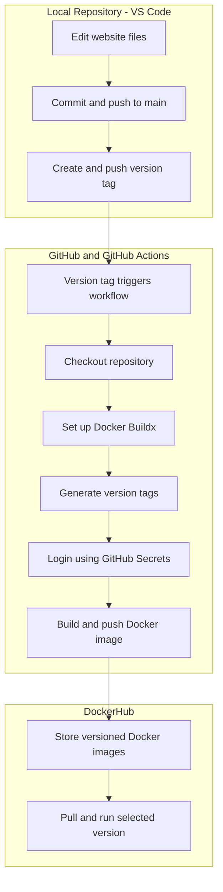

### How the Process Works

First, I modify the website in VS Code and push the changes to GitHub.

After creating and pushing a version tag, GitHub Actions starts the workflow automatically.

The workflow generates semantic version tags, authenticates with DockerHub using repository secrets, and builds and publishes the Docker image.

DockerHub stores the different versions so that an older version can be downloaded and used if necessary.

Normal commits to `main` do not trigger the final workflow. Only version tags activate it.

### Platform Compatibility

The published images use the `linux/amd64` architecture. Since my Mac uses ARM64, I specify `--platform linux/amd64` when pulling and running these images locally.


## Part 1 - Docker Container Image

### Website Content

I created a simple website about CEG3120 Project 6.

The website contains two HTML pages and one CSS file:

- [index.html](web-content/index.html): main page of the website.
- [about.html](web-content/about.html): information about the project and technologies used.
- [style.css](web-content/style.css): styling for both pages.

### Dockerfile

I created a [Dockerfile](Dockerfile) in the root directory of the repository.

The Dockerfile contains:

```dockerfile
FROM httpd:2.4

COPY web-content/ /usr/local/apache2/htdocs/
```

The `FROM` instruction uses Apache HTTP Server as the base image.

The `COPY` instruction copies the website files into the default Apache web directory.

### Building the Docker Image

To build the image from the root directory of the repository, I used:

```bash
docker build -t ceg3120-site:local .
```

The image was built successfully.

For DockerHub, images must be tagged using the DockerHub username, repository name, and image tag.

### Running the Container

I started the container using:

```bash
docker run -d --name ceg3120-web -p 8080:80 ceg3120-site:local
```

The command runs the container in the background and maps port 8080 on my computer to port 80 inside the container.

To check the container status, I used:

```bash
docker ps
```

The website is available at:

- http://localhost:8080/index.html
- http://localhost:8080/about.html

### Testing and Validation

**Docker container running**

The following screenshot shows the container running with the correct image and port mapping.

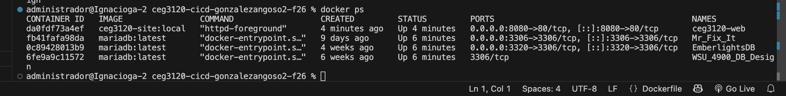

**Home page**

This screenshot shows the Home page served by the Docker container with CSS applied.

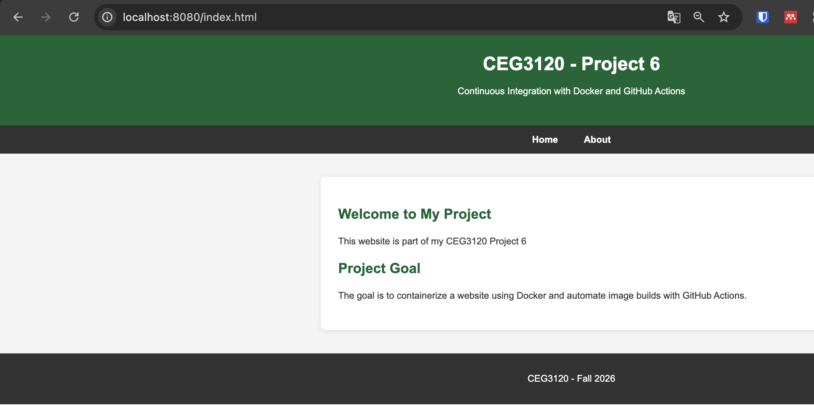

**About page**

This screenshot shows the About page served by the Docker container, confirming that both HTML pages and the CSS work correctly.

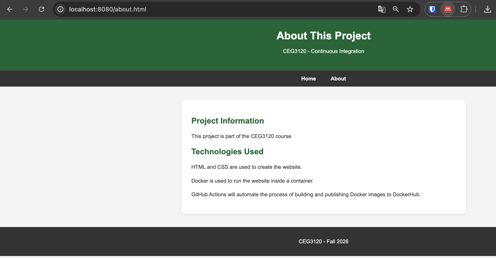


### Publishing the Image to DockerHub

I created a public DockerHub repository to store my container images.

DockerHub repository:
[ignaciooga/ceg3120-site](https://hub.docker.com/r/ignaciooga/ceg3120-site)

First, I tagged my local Docker image using my DockerHub username and repository name:

```bash
docker tag ceg3120-site:local ignaciooga/ceg3120-site:latest
```

I logged in to DockerHub using my username and a Personal Access Token with Read & Write permissions:

```bash
docker login -u ignaciooga
```

The PAT was entered at the password prompt and was not stored in the GitHub repository.

Then I pushed the image to DockerHub:

```bash
docker push ignaciooga/ceg3120-site:latest
```

The image was successfully published with the `latest` tag.

### Pulling and Testing the DockerHub Image

To verify the published image, I used:

```bash
docker pull ignaciooga/ceg3120-site:latest
```

Then I started a new container using the DockerHub image:

```bash
docker run -d --name ceg3120-from-hub -p 8081:80 ignaciooga/ceg3120-site:latest
```

I used port 8081 because my original local container was already running on port 8080.

To verify the running containers, I executed:

```bash
docker ps
```

The following screenshot shows the successful DockerHub push and pull commands and the running container using port 8081.

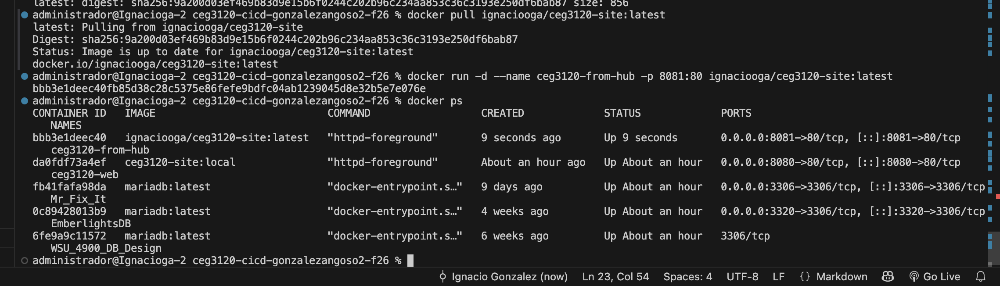

### DockerHub Image Validation

**Home page from DockerHub image**

The following screenshot shows the Home page running from the DockerHub image on port 8081 with the CSS applied.

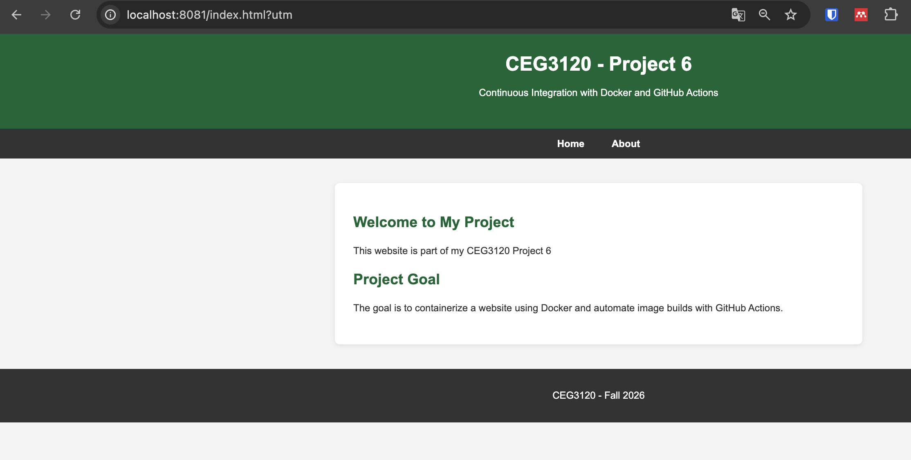

**About page from DockerHub image**

This screenshot shows the About page running from the same container, confirming that both HTML pages and the CSS work.

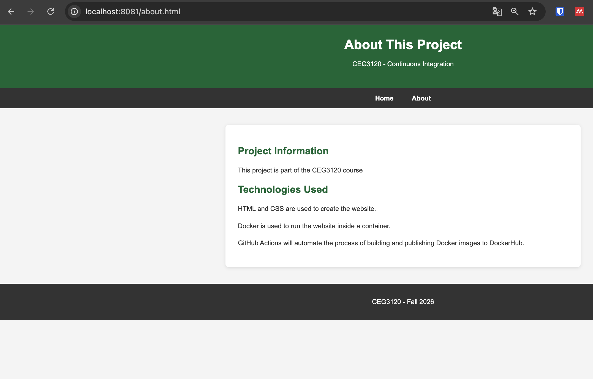

Both pages worked correctly when running the published DockerHub image.


## Part 2 - GitHub Actions and DockerHub

### GitHub Repository Secrets

I configured two repository secrets in GitHub Actions:

- `DOCKER_USERNAME`: stores my DockerHub username.
- `DOCKER_TOKEN`: stores my DockerHub Personal Access Token.

I created a DockerHub PAT with Read & Write permissions. These secrets allow GitHub Actions to authenticate with DockerHub without exposing credentials in the workflow file.

The following screenshot shows both repository secrets configured in GitHub.

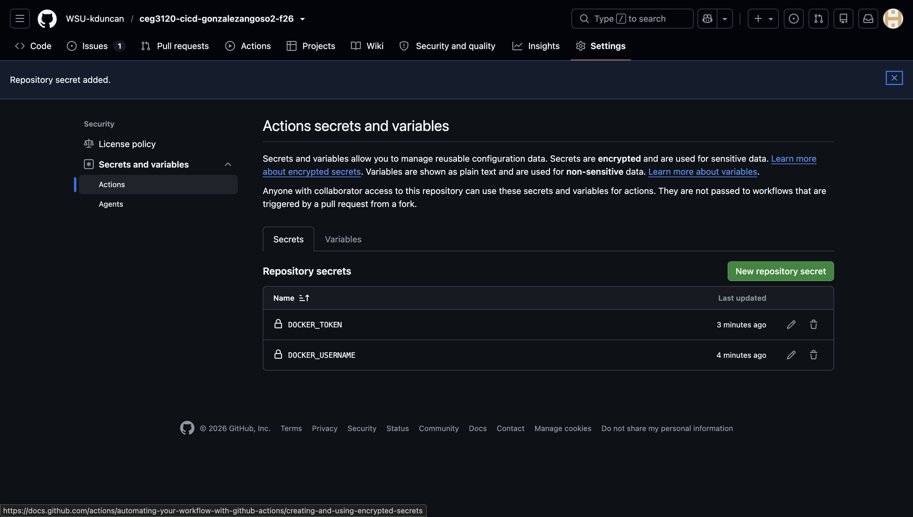

To create the DockerHub Personal Access Token, I went to DockerHub Account Settings, opened Personal Access Tokens, and created a token with Read & Write permissions.

Then, in my GitHub repository, I went to Settings > Secrets and variables > Actions and selected New repository secret. I added `DOCKER_USERNAME` with my DockerHub username and `DOCKER_TOKEN` with the access token.


### GitHub Actions Workflow

I created a GitHub Actions workflow called `docker-publish.yml` to automatically build and push Docker images to DockerHub.

The workflow is triggered when a commit is pushed to the `main` branch.

The workflow performs these steps:

1. Checks out the GitHub repository.
2. Sets up Docker Buildx.
3. Logs in to DockerHub using repository secrets.
4. Builds the Docker image using the Dockerfile.
5. Pushes the image to `ignaciooga/ceg3120-site:latest`.

### Using the Part 2 Workflow in Another Repository

To use this workflow in another repository, I would need to update the DockerHub image name, configure the `DOCKER_USERNAME` and `DOCKER_TOKEN` repository secrets, and make sure the Dockerfile is in the correct location.

I would also need to check that the workflow uses the correct branch name. In Part 2, the workflow was configured to run only when changes were pushed to `main`.


### Testing the Main Branch Trigger

I pushed commit `19d9fce` to the `main` branch, which automatically triggered the workflow.

After correcting the DockerHub authentication, I re-ran the workflow successfully.

The following screenshot shows the successful execution of GitHub Actions, including the commit SHA and the `main` branch.

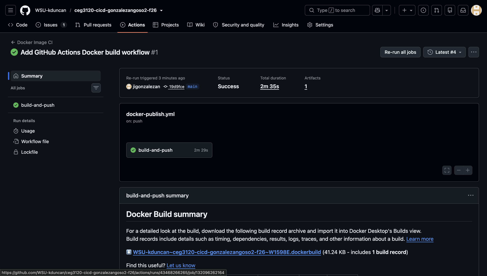


### Testing a Different Branch

To verify that the workflow only runs on the `main` branch, I created a new branch called `test-no-ci`.

I added a file called `branch-test.txt` and committed the changes.

Then I pushed the new branch to GitHub using:

```bash
git push -u origin test-no-ci
```

The following screenshot shows the successful push to the test branch.

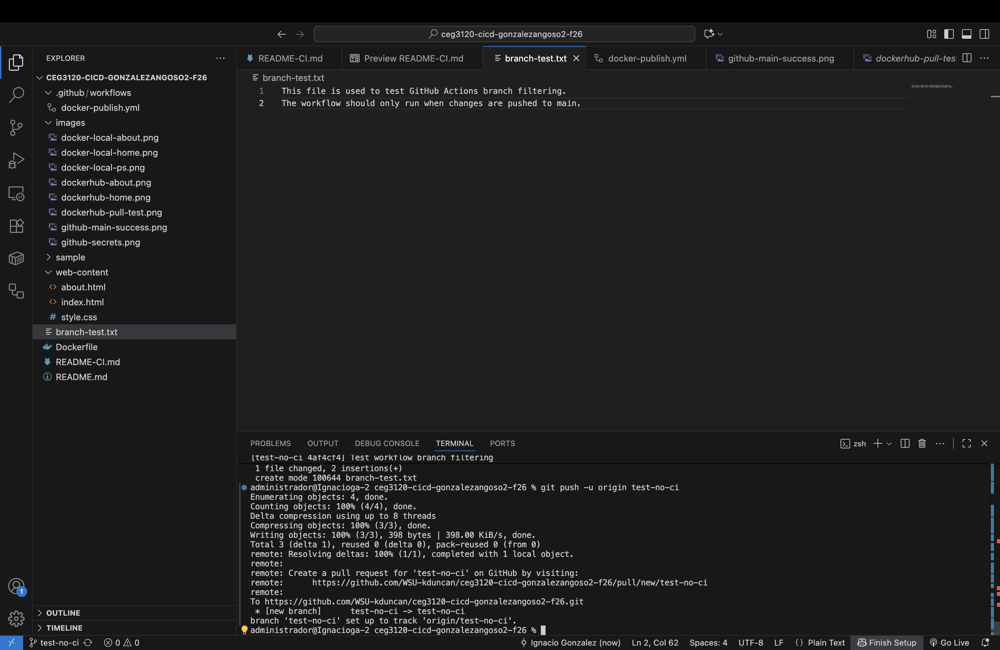

After pushing the changes, I checked the GitHub Actions page.

No new workflow run was triggered by the `test-no-ci` branch. Only the previous runs from `main` appeared.

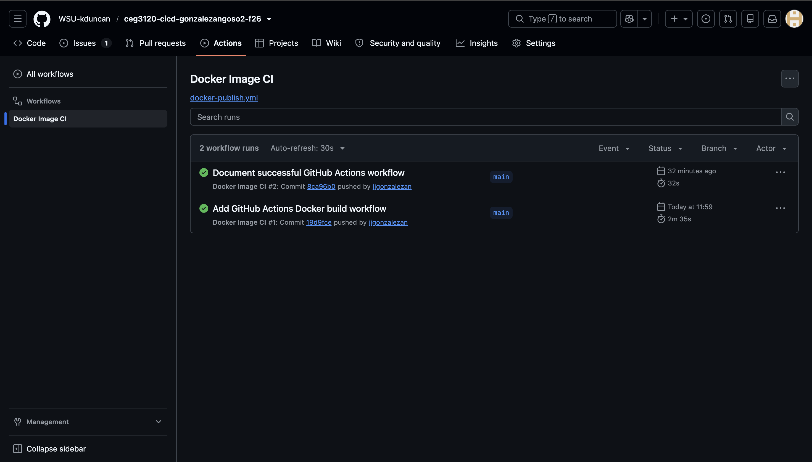

This confirms that the workflow is correctly configured to run only when changes are pushed to the `main` branch.

After completing the test, I switched back to `main` to continue working on the project.


### Testing Automatic Docker Image Updates

To test the automatic image publishing process, I updated the `index.html` file by adding the following message:

"Update: This website is automatically published using GitHub Actions!"

I committed the change and pushed it to the `main` branch.

Commit: `7dec80b`

GitHub Actions automatically started the Docker Image CI workflow. The workflow successfully built and pushed the updated Docker image to DockerHub.

The following screenshot shows the successful workflow execution.


### Pulling the Updated Image

After the workflow completed, I downloaded the updated image from DockerHub.

Since my Mac uses ARM64 and the GitHub Actions image was built for AMD64, I specified the platform:

```bash
docker pull --platform linux/amd64 ignaciooga/ceg3120-site:latest
```

Then I started a new container using port 8082:

```bash
docker run -d --platform linux/amd64 --name ceg3120-updated -p 8082:80 ignaciooga/ceg3120-site:latest
```

I used `docker ps` to verify that the container was running.

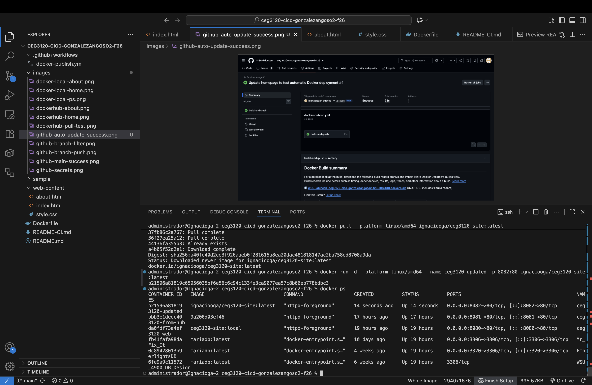

### Verifying the Website Update

I opened `http://localhost:8082/index.html` in my browser.

The updated message appeared on the Home page, confirming that the image published by GitHub Actions contained my latest website changes.

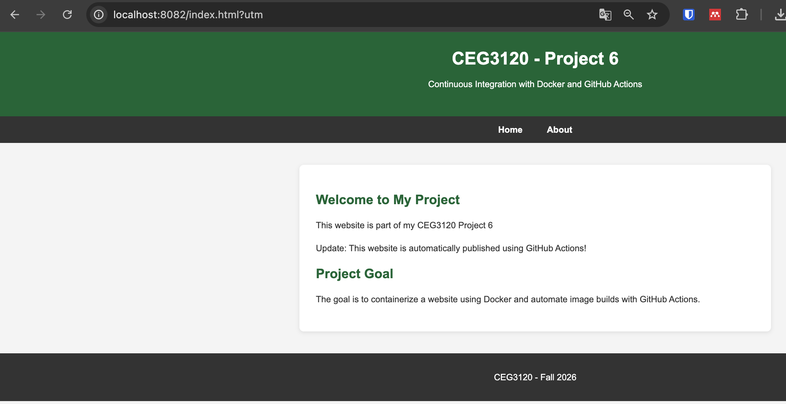

This test confirms that pushing changes to the `main` branch automatically builds and publishes an updated Docker image to DockerHub.


### Part 2 Workflow Permanent Link

The following link points to the GitHub Actions workflow used in Part 2 of this project.

[Part 2 - Docker Image CI Workflow](https://github.com/WSU-kduncan/ceg3120-cicd-gonzalezangoso2-f26/blob/ba43acf5fcf0aca37d5bb0f7a525f3e8c5c3bc9a/.github/workflows/docker-publish.yml)

This version of the workflow builds and pushes the Docker image to DockerHub whenever changes are pushed to the `main` branch.

I saved this permanent link before making changes for Part 3, so the original workflow can still be reviewed.


## Part 3 - Semantic Versioning

### Configuring Semantic Versioning

In this part, I modified the GitHub Actions workflow to use semantic versioning for Docker images.

Instead of running on every push to `main`, the workflow now runs when a version tag matching `v*.*.*` is pushed to GitHub.

I added `docker/metadata-action@v6` to automatically generate Docker image tags based on the Git version.

The workflow uses the following tags:

- `1`: major version.
- `1.0` or `1.1`: major and minor version.
- `latest`: most recently published version.

The generated tags and labels are passed to `docker/build-push-action@v7`, which builds and publishes the Docker image to DockerHub.

### Part 3 GitHub Actions Workflow

The final version of my GitHub Actions workflow is available here:

[Part 3 - Docker Image CI Workflow](https://github.com/WSU-kduncan/ceg3120-cicd-gonzalezangoso2-f26/blob/main/.github/workflows/docker-publish.yml)

This workflow automatically builds and publishes Docker images when a version tag is pushed to GitHub.

### Checking Git Tags

To check the existing version tags in my repository, I used:

```bash
git tag -l
```

This command lists the Git tags created in the repository, including `v1.0.0` and `v1.1.0`.

The following screenshot shows the version tags created in my repository.

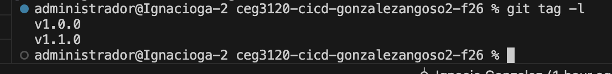

### Using the Workflow in Another Repository

To use this GitHub Actions workflow in another repository, I would need to make a few changes:

- Copy the `docker-publish.yml` file into the new repository's `.github/workflows/` folder.
- Update the DockerHub image name (`ignaciooga/ceg3120-site`) to match the new project.
- Configure the repository secrets `DOCKER_USERNAME` and `DOCKER_TOKEN`.
- Make sure the Dockerfile and website files are in the correct locations.
- Create and push a version tag matching `v*.*.*` to trigger the workflow.

After these changes, GitHub Actions would automatically build and publish the Docker image for the new repository.

### Publishing Version 1.0.0

I created the first version using these commands:

```bash
git tag -a v1.0.0 -m "Release version 1.0.0"
git push origin v1.0.0
```

Pushing this tag automatically triggered the GitHub Actions workflow.

The workflow completed successfully and published the image with the tags `1`, `1.0`, and `latest`.

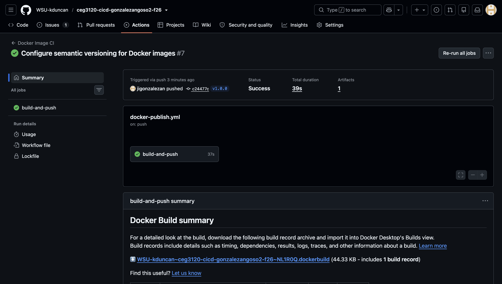

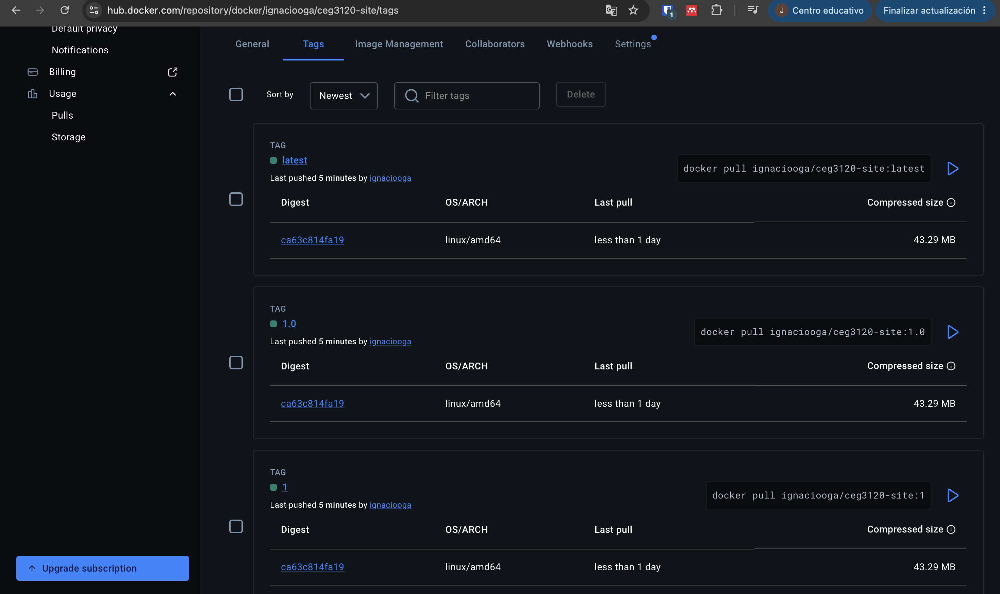

### Publishing Version 1.1.0

For the second version, I modified `web-content/index.html` to add a new section called "What's New in Version 1.1.0".

After committing and pushing the change to `main`, I created and published the new version:

```bash
git tag -a v1.1.0 -m "Release version 1.1.0"
git push origin v1.1.0
```

GitHub Actions automatically built and published the updated Docker image.

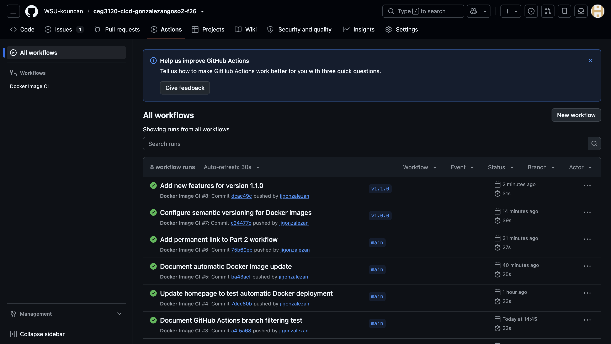

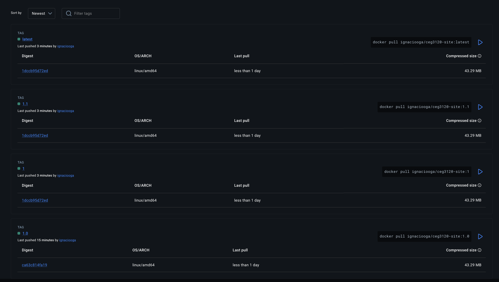

### Verifying Docker Image Versions

After publishing version 1.1.0, I checked the DockerHub repository.

The tags `latest`, `1`, and `1.1` point to the new version and share the same digest.

The `1.0` tag still points to the previous image with a different digest.

This confirms that semantic versioning works correctly and that older Docker image versions remain available.

The Docker images and their different version tags are available in my DockerHub repository:

[View DockerHub Image Versions](https://hub.docker.com/r/ignaciooga/ceg3120-site/tags)


### Testing the Tag Trigger

I tested that the workflow only runs when a version tag is pushed.

After pushing commit `1e96073` to `main` without creating a new version tag, I checked GitHub Actions.

No new workflow execution appeared. The latest execution was still the successful `v1.1.0` release.

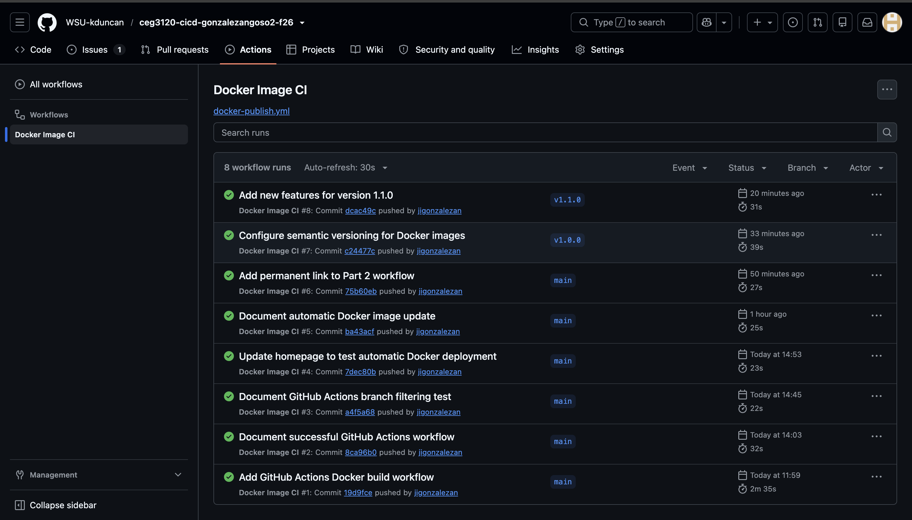

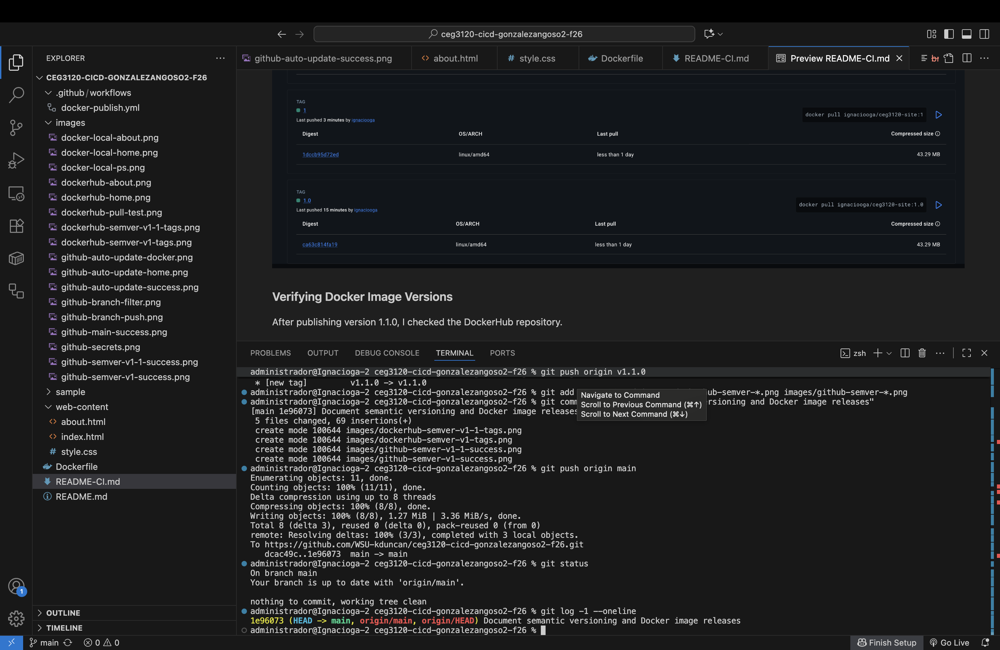

### Testing Docker Image Rollback

I tested that both the previous and current Docker image versions could run independently.

First, I downloaded and started version `1.0`:

```bash
docker pull --platform linux/amd64 ignaciooga/ceg3120-site:1.0
docker run -d --platform linux/amd64 --name ceg3120-v1-0 -p 8083:80 ignaciooga/ceg3120-site:1.0
```

The website at `http://localhost:8083/index.html` displayed the original content without the version 1.1.0 section.

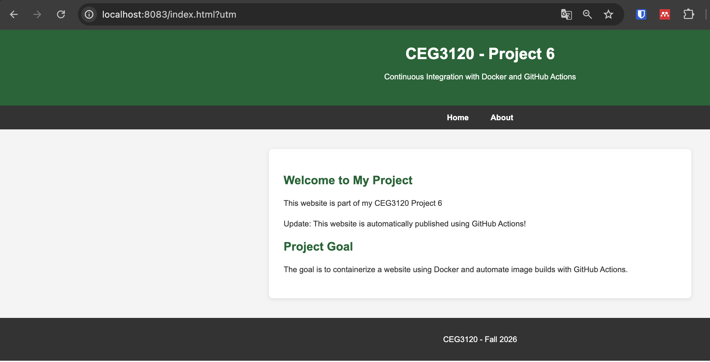

Next, I downloaded and started version `1.1`:

```bash
docker pull --platform linux/amd64 ignaciooga/ceg3120-site:1.1
docker run -d --platform linux/amd64 --name ceg3120-v1-1 -p 8084:80 ignaciooga/ceg3120-site:1.1
```

The website at `http://localhost:8084/index.html` included the new "What's New in Version 1.1.0" section.

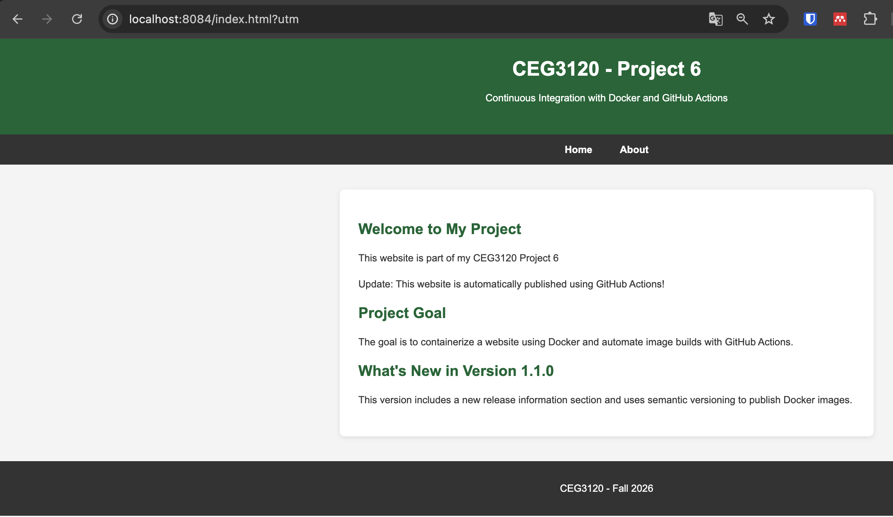

I also used `docker ps` to verify that both containers were running at the same time on different ports.

This confirms that previous Docker image versions remain available and can be used for rollback.

### Conclusion

I successfully configured GitHub Actions to automatically build and publish versioned Docker images to DockerHub.

The workflow is now triggered by Git version tags instead of normal pushes to the `main` branch.

## Resources and References

The following resources were used while completing this project:

- [CEG3120 Project 6 Instructions](https://github.com/pattonsgirl/CEG3120/tree/main/Projects/Project6) - Used to understand the project requirements, documentation, and testing procedures.

- [Docker Documentation](https://docs.docker.com/reference/dockerfile/) - Used as a reference for Dockerfile instructions and container images.

- [Docker CI with GitHub Actions](https://docs.docker.com/build/ci/github-actions/) - Used as a reference for automating Docker image builds with GitHub Actions.

- [GitHub Actions Documentation](https://docs.github.com/en/actions) - Used to understand workflows, triggers, and repository secrets.

- [Docker Metadata Action](https://github.com/docker/metadata-action) - Used as a reference for generating Docker image tags with semantic versioning.

- [Mermaid Documentation](https://mermaid.js.org/) - Used as a reference for documenting the continuous integration process with a flowchart.

- [ChatGPT](https://chatgpt.com/) as a support tool during this project.

    I mainly used it to help translate some explanations into English, find useful documentation and references, check that I had completed all the rubric requirements, and organize and improve the README documentation.

    Some example prompts were:

    - "Can you help me translate this into English?"
    - "Where can I find documentation about Docker and GitHub Actions?"
    - "Can you check if I have completed all the requirements in the rubric?"
    - "Can you help me organize the README documentation?"
